# MineUX

**A Linux desktop inside Minecraft.** MineUX is a Fabric mod for Minecraft 26.2 with a tiling
window manager configured like Hyprland, terminals running their own shell (muxsh), a home desk in
place of the title screen and an Esc desk in place of the pause menu. Press **Right Shift** in a
world and the desktop opens over the game while the game keeps running.

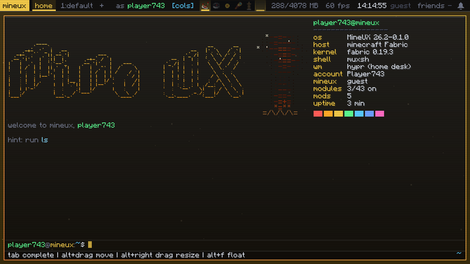

It comes in two editions:

- **MineUX** (full): the desktop, plus the visual modules (HUD, world, camera and hand, self and
  cosmetics).
- **MineUX Lite**: the desktop without the visual modules.

Both run on OpenGL and on Vulkan. The full feature tour, written for the Modrinth page, is in
[docs/showcase/modrinth.md](docs/showcase/modrinth.md).

## What it does

**The desktop.** Right Shift opens it over the game, and nothing pauses. The home desk and the Esc
desk replace the title screen and the pause menu. Their buttons are still there: click one or type
it (`worlds`, `play 1`, `servers`, `join <n>`).

**A window manager like Hyprland.** Windows tile in columns or dwindle layouts, and you can float,
pin, group and fade them. Pinned windows stay over the game. SUPER is Alt by default. Everything is
set in a real `hyprland.conf` (gaps, gradient borders, bezier animations, binds), and `hyprctl`
reloads, binds and dispatches.

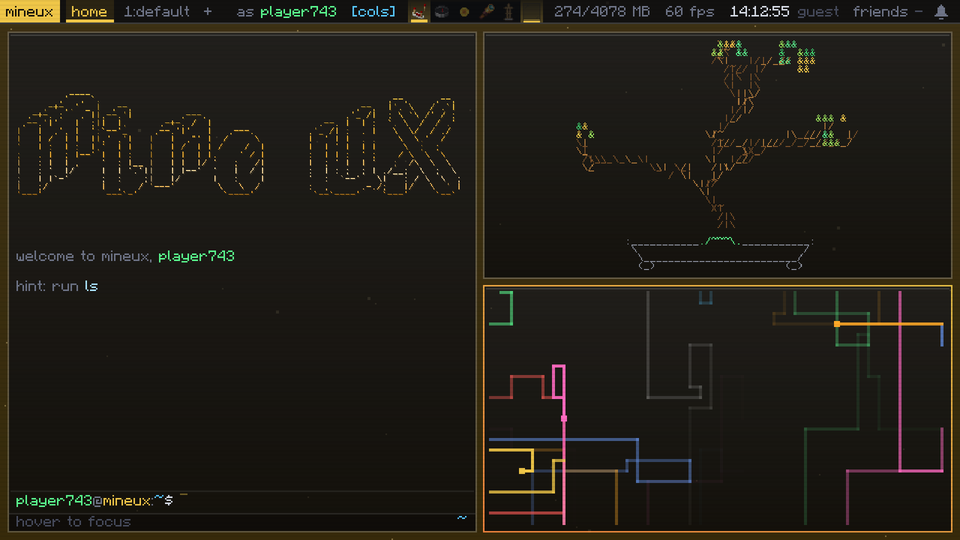

**muxsh.** Tab completion and history. `join <address>` (or a name or number from your server
list) connects to a server straight from the terminal, on the home desk or from inside a world,
with no trip back to the main menu. `quit` closes the game, and `reboot` closes it and starts it
again. Both ask first, and both save a world you're in. `neofetch`, `pipes.sh`, `bonsai` and `art` for the
desktop art. `lookup <player>` shows stats in a window, `bind` runs any command on a key, and
`accounts` switches Minecraft accounts. Every setting is a folder you can `ls`, `cd` and
`toggle`.

**Workstations.** Each one keeps its own windows and its own module settings. A module that is on
in one workstation stays off in the others. Hold SUPER and press a number to switch, in game too.

**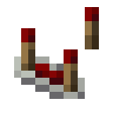 The tray and Glass settings windows.** Each
module group is an item on the bar. Hover a group to see its modules, click one to open its Glass
settings window, and right-click to flip it.

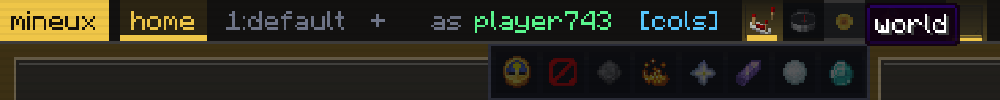

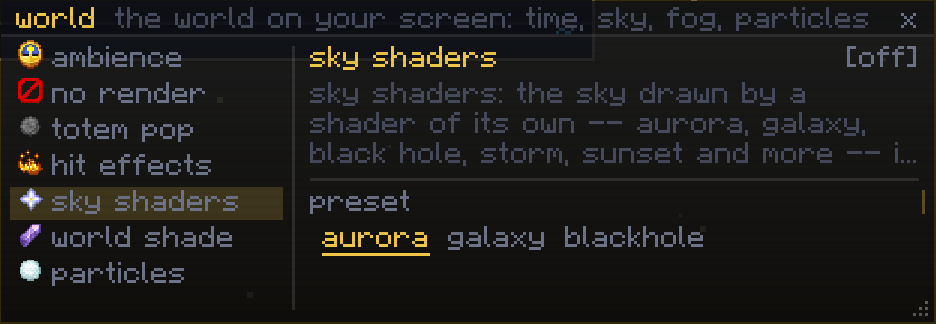

**Visuals (full edition).** They change only what you see, and nothing extra is sent to the server.

| | Group | Modules |
|---|---|---|
| 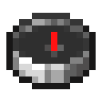 | **hud** | crosshair, hotbar, scoreboard, chat, main menu, theme textures |
|  | **world** | ambience, no render, totem pop, hit effects, sky shaders, world shaders, particles, item physics |
| 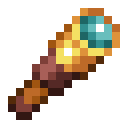 | **camera** | zoom, freelook, camera tweaks, smooth camera, motion blur, auto f5, no fov, no bob, no hurt cam, stretched, clear weather, view model, hand view, swing animations, swing speed, no swing, inspect, glint colour, hand shaders |
| 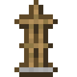 | **self** | body view, move animations, cosmetics, jump effect, player model, skin changer, armour shaders, cursor trail, fake cursor |

**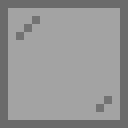 Screens.** Your monitors and
windows become live screens in the world. Arrange them with a freecam, which is purely visual and
hides other players. Capturing works on Windows.
**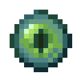 Friends' screens:** share one live with MineUX
friends on the same multiplayer server. Both of you have to turn screens on for each other, and
sharing starts off every time.

The icons are the items the code shows on the tray. See
[docs/showcase](docs/showcase/README.md) for the full feature-to-item table.

## Online features are optional

MineUX starts at a ly-style greeter where you sign in to a [mineux.com](https://mineux.com) account
or continue as a guest. The friends list, DMs, the #public chat, notifications and Screens sharing
need an account. Guests send nothing to mineux.com, and the rest of the mod works without an
account. See the [privacy policy](https://mineux.com/privacy.html).

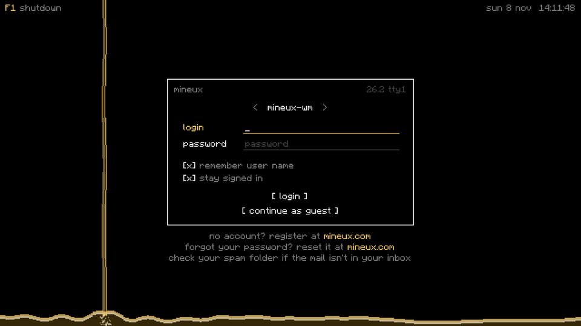

## Building

You need:

- JDK 25
- the Rust toolchain for MSVC (`stable-x86_64-pc-windows-msvc`), to build Screens' native
  capture library in `native/`

Then run:

```
./gradlew build                  # both jars, the tests and the source checks
./gradlew build -Pedition=lite   # the same, with lite as the dev-run edition
./gradlew runClient              # a dev run of the full edition (-Pedition=lite for lite)
```

The jars land in `build/libs/`: `mineux-<mc>-<version>.jar` is the full edition and
`...-lite.jar` is lite. The build runs `cargo build --release` in `native/`. If cargo is
missing, it uses an existing `native/target/release/screens.dll` instead.

## Licence

All rights reserved. The source is published so you can read it; it is not open source. You
may download the official releases and play with them, and build the code yourself for your own
use. Anything else (copying, redistributing, selling, or publishing modified versions) needs our
written permission. See [LICENSE.md](LICENSE.md).

## Contributing

Issues and pull requests are welcome. Every contribution comes in under the contributor agreement
in [CONTRIBUTING.md](CONTRIBUTING.md). Read it before you open a pull request.

## Credits

Microsoft account sign-in: based on code by riverxia.
